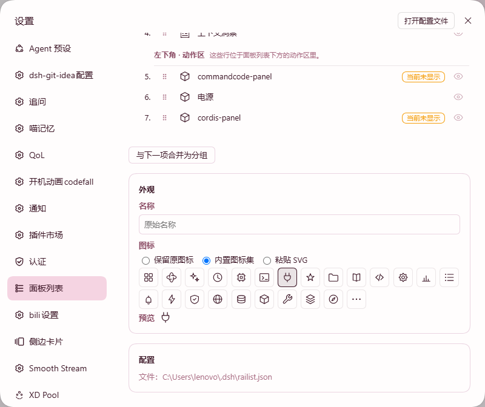

# dsh-railist

**English** | [中文](#中文)

---

## English

Manage the whole DSH left column as one list: reorder rows across the panel list and the footer action row, rename them, change their icons, hide them, and fold them into Groups. Everything is configured in a new Settings tab and applies immediately.

> A fork of [dsh-panellist](https://github.com/qwq1999/dsh-panellist). Upstream manages the panel list alone; this fork extends it to a single sequence spanning two seats.

---

## Features

- **One sequence across seats** — the panel list and the footer action row are sorted as a single list, so a row can be dragged from one into the other.
- **Reorder by drag** — drag any row to a new position; the rail follows the list live.
- **Rename and re-icon** — give any row your own label and pick its icon from a built-in set.
- **Show / hide** — take a row off the rail without uninstalling its plugin.
- **Groups** — fold several rows into one Group row with a flyout menu; ungroup at any time.
- **Appearance override** — adjust the rail's own look from the Settings tab.
- **Config file's full path** — shown in Settings so you can back it up or edit it.

The Settings row itself always stays last and cannot be dragged, and every change is written to disk only when you press Save.

## Screenshots

| Settings → Panel list | Appearance override | A Group menu on the rail |
| :-: | :-: | :-: |
|  |  |  |

## Installation

```bash
dsh plugin --profile web add dsh-railist
```

Then restart DSH. To remove it:

```bash
dsh plugin --profile web remove dsh-railist
```

## Compatibility

| Requirement | Version |
| --- | --- |
| DSH | `>=0.2.0-rc.2 <0.3.0-0` |
| Node | `^22.19.0 \|\| >=24.0.0` |
| Profile | `web` |
| Platform | Windows / macOS / Linux desktop |

## Configuration

Your settings live in `~/.dsh/railist.json`. The full path is also shown in the Settings tab. If a row's plugin is missing or disabled, the row is kept in the file and marked as missing rather than being deleted.

## License

MIT

---

## 中文

把 DSH 左侧栏当成一整条列表来管理：跨「面板区」与「底部动作区」调整顺序、重命名、换图标、隐藏，以及把若干行折叠成分组。全部在设置页完成，改完立即生效。

> 本项目 fork 自 [dsh-panellist](https://github.com/qwq1999/dsh-panellist)。上游只管理面板区；本 fork 把它扩展成跨越两个区域的同一条序列。

---

## 功能

- **跨区域同一条序列** —— 面板区与底部动作区当成一条列表排序，所以一个行可以从一个区域拖进另一个区域。
- **拖动排序** —— 把任意行拖到新位置，左侧栏实时跟随。
- **重命名与换图标** —— 给任意行起自己的名字，并从内置图标集里挑图标。
- **显示 / 隐藏** —— 把某一行从左侧栏隐藏，而不必卸载它的插件。
- **分组** —— 把若干行折叠成一个分组行（带展开菜单），随时可以解组。
- **外观覆盖** —— 在设置页调整左侧栏自身的外观。
- **配置文件全路径** —— 设置页直接显示，方便你备份或手动编辑。

「设置」那一行固定在最下方、不可拖动；所有改动都要点保存才会写进磁盘。

## 效果图

| 设置 → 面板列表 | 外观覆盖 | 左侧栏上的分组菜单 |
| :-: | :-: | :-: |
|  |  |  |

## 安装

```bash
dsh plugin --profile web add dsh-railist
```

装完重启 DSH。卸载：

```bash
dsh plugin --profile web remove dsh-railist
```

## 兼容版本

| 要求 | 版本 |
| --- | --- |
| DSH | `>=0.2.0-rc.2 <0.3.0-0` |
| Node | `^22.19.0 \|\| >=24.0.0` |
| Profile | `web` |
| 平台 | Windows / macOS / Linux 桌面端 |

## 配置

配置存在 `~/.dsh/railist.json`，设置页里也会显示完整路径。如果某一行的插件被卸载或停用，这一行会保留在配置里并标记为「已缺失」，不会被自动删掉。

## 许可证

MIT
