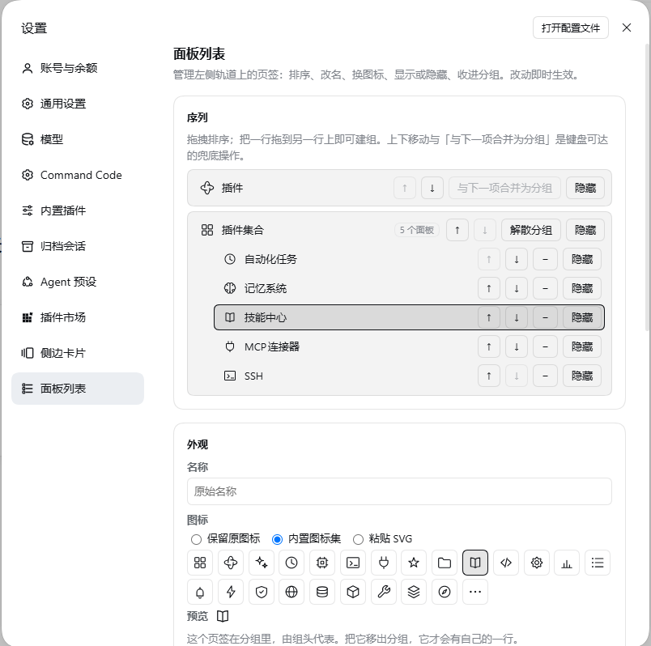
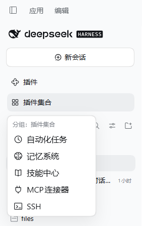

# dsh-panellist

The management plugin for the Panellist in the DSH (DeepSeek Harness) client.

The Panellist is the column on the left of the session UI: the global entries contributed by individual plugins — plugins, automation tasks, skill center, memory system, SSH, MCP connectors… They come from different plugins, each declares its own order, and each decides its own icon and name.

This plugin lets the **user** take over: which Panel entries appear on the rail, in what order they appear, what they are called, what icon they use, and which entries are folded into a Group. All configuration is done in a new tab in Settings, and changes take effect immediately.

> Status: **implemented**. This README pair is the whole specification — there is no separate design document: behaviour is §2–§3, the configuration and the interfaces are §4, the compatibility contract is §5, how to install it is §6, and how it is built is §7. The normative configuration shape is [`docs/schema/config.schema.json`](docs/schema/config.schema.json).
>
> Three refinements to the original design (all discovered during implementation and backfilled into this document): the rail id of a Group is `dsh-panellist:<groupId>`; unconfigured Panel entries are always listed on the rail, but an `order` is written only once the Sequence is non-empty (i.e. after your first structural change); and the `/panellist/api/reveal` endpoint was added to implement "Open config file".

## Screenshots

| Settings → Panel list | A Group menu on the rail |
| :-: | :-: |
|  |  |

---

## 1. Why it is needed

The DSH Panellist is a **read-only projection**: the shell enumerates the registrations in the `sidebar.panellist` slot and renders them sorted by the order **each item reported at registration time**. No official API is provided for rewriting someone else's registration:

- Order is read-only — a plugin can only decide the `order` of its own item;
- There is no concept of a "Group" — one row is one Panel entry;
- The icon is decided by the component the contributor provides, and the name is decided by the contributor's `label`;
- The icon of the Settings navigation tab can only be picked from a list built into the kernel.

So this plugin has to use two levers at the same time, and keep DOM intervention to a minimum:

1. **Registry rewrite** — rewrite the order, name and icon component on the registration at runtime (the registration object is not frozen and is handed back by the slot registry, so a post-hoc write is visible to the shell); this plugin's changes do not touch any plugin's own page.
2. **Minimal DOM/CSS reprojection** — only one thing cannot be done through the registry: taking a row off the rail. Group rows are registrations too (registered by this plugin), so their row box, highlight, tooltip and collapsed-state behavior still come from the shell; the popup menu is an overlay and does not modify native rows.

---

## 2. Behavior spec (confirmed)

### 2.1 What it manages

- **All** registrations in the Panellist are treated alike: kernel-shipped items (plugins, automation tasks, skill center, memory system, SSH, MCP connectors) and items registered by third-party plugins can all be managed.
- This plugin's own settings tab is not in the Panellist, so it is not managed.
- Real Panel entry ids are discovered at runtime and are not hard-coded; the ids in this document's examples are illustrative only.

### 2.2 Sequence model

The Sequence is a series of **ordered items**, each of which is either a **single Panel entry** or a **Group**:

- Each Panel entry appears **exactly once** in the whole Sequence (the Sequence is a partition of the set of Panel entries, with no duplicates);
- A Group itself occupies one position in the Sequence and contains an **ordered** subset of Panel entries;
- **Only one level** of nesting is allowed (a Group cannot contain another Group);
- An empty Group is invalid; a Group with only 1 item is allowed, but the management panel warns about it.

The design conversation settled the notation this way (`G{…}` = one Group):

| Notation | Interpretation |
| --- | --- |
| `a c b d e` | `[a][c][b][d][e]` |
| `a b c` | `[a][b][c]` |
| `a dropdown(b c d e)` | `[a][G{b,c,d,e}]` |
| `a dropdown(b d e c)` | `[a][G{b,d,e,c}]` |
| `a dropdown(b e c)d` | `[a][G{b,e,c}][d]` |
| `dropdown(a b c)d e` | `[G{a,b,c}][d][e]` |

### 2.3 Shown / Hidden

- There are only two states: **Shown** / **Hidden** (there is no third "disabled" state).
- Hidden = it no longer appears on the rail, but the Panel entry itself still exists and is still usable (it can be selected from the management panel, and activated by other plugins or keyboard shortcuts), and the functionality of the plugin it belongs to is unaffected.
- Exception: **if a Hidden Panel entry is currently active, its row is shown temporarily** — avoiding the case where "the user is still on this page, but the rail has no entry for it".
- **Members of a Group can be hidden too**, where "hidden" means "left out of the Group menu": a member's rail row is already suppressed by the Group, so for a member hiding only affects the flyout. The member stays in the Group — the count, the ordering and the Group trigger highlight all still see it.
- **A missing member is left out of the Group menu automatically** (its registration is gone, and a disabled "missing" row in the menu only took up room the user cannot act on). It stays in the configuration and in the settings page's "missing panels" list, waiting to be cleaned up.

### 2.4 Label override

- A pure display-layer override, affecting only three places: the text of the rail row, the tooltip text in the collapsed state, and the accessible name.
- It does not change same-name displays elsewhere in DSH (Settings, command palette, etc.), and does not change the original name declared by the contributor.
- The first version is a **single string**, effective for all languages.

### 2.5 Icon override

Three sources, and you can switch back to the original icon at any time:

1. **Keep the original icon** (default);
2. **Built-in icon set** — 24 inline vector glyphs shipped with this plugin (zero dependencies, usable offline). They are drawn to the spec the icons beside them in the rail are drawn to — the **`Icon*OutlineRegular`** weight: `viewBox="0 0 16 16"`, `fill="none"`, `stroke="currentColor"` at **1px**, geometry on the 16 grid at half-step coordinates inside roughly 2…14, round caps and joins, `aria-hidden`, no ids and no external references. Three of them are the shipped artworks of the rail's own defaults, so a panel given one of them looks identical to the entry it replaces: `puzzle` is the plugin pinwheel (`IconPluginPinwheelOutline`), `clock` the clock (`IconClockOutline`), `more` the ellipsis (`IconEllipsisOutline`). The set is checked mechanically at 16px next to those shipped artworks, and its ink extents are measured against them;
3. **User-uploaded icon** — paste SVG source;
   - Allowlist sanitization: removes `script`, `foreignObject`, event attributes, and external references (cases where `href`/`xlink:href` point outside);
   - A single SVG is capped at **64 KB**;
   - Inline rendering (not ``), so it follows the theme's colors.

The **settings navigation row has its own dedicated glyph** (a panel list, at the heavier `Icon*OutlineMedium` 1.3px weight that column is drawn at) — see §3.

### 2.6 Groups and Group triggers

- A Group trigger has its **own** icon and name; by default they are pre-filled from the icon and name of the "first item in the Group" (a common name is "More"), and the user can change them. When no name is set, the trigger text is resolved from the first live member at render time — nothing is baked into the config.
- The Group trigger's **whole row is clickable**, and clicking it expands the Group menu; a whole-row click is always used to expand the menu and never navigates to a page. The menu lists the Group's members and nothing else: an "Overview" link to the Group's own page used to sit in its title row and was removed on user feedback. That page still exists as the Group's `main` fallback (so selecting the Group id programmatically cannot error) but has no entry point of its own.
- When any item in the Group is active, the **Group trigger is highlighted**, so the user can tell which Group the current page is in without expanding the menu.
- When a Group is created, it is inserted at **the original position of its topmost member** — that is, the Group "grows" where its members already were. The model guarantees this (`createGroup` anchors on the *identity* of the row above the topmost member), so it holds for any gesture.

### 2.7 Group menu

- **Opens on click** (not on hover, to avoid accidental activation).
- Lists the members the user can act on: a member that is hidden (§2.3) or missing is left out, and a Group whose members are all hidden says so instead of showing an empty card.
- Keyboard accessible: `Enter`/`Space` expands, `Esc` closes, and the up/down arrow keys move within the Group.
- When the sidebar is collapsed into the 56 px rail, the menu always **flies out to the right** (flyout).
- The menu scrolls when the number of items in the Group exceeds the visible height; the first version does **not** do an in-Group search box.

### 2.8 Unconfigured items and Orphans

- A newly installed plugin registers a Panel entry you have not touched yet → it is **listed in the sequence straight away** (after the configured entries, arranged by its own order); there is nothing to opt into first.
- The contributor of a Panel entry is uninstalled while the config still holds it → the config is **kept**, the management panel marks it "missing", and offers a "Clean up orphans" button.
- Until you make a STRUCTURAL change (a drag, creating or dissolving a group), this plugin writes **no order at all**: the rail keeps the order its contributors chose. A rename, a re-icon or a hide only overrides that one entry and leaves the order alone — which is what "we do not touch what you did not ask us to touch" means in practice.

### 2.9 How a change takes effect

Config changes **take effect immediately**: no need to restart DSH, no need to reload any plugin, and no need to reload the page. That holds for *every* edit, including the ones that write nothing at all: the rewrite pass compares a digest of everything the rail renders (order, name, icon, shown/hidden) and re-projects when it moves, so a second icon pick or a second rename lands on the rail just like the first one did.

### 2.10 Scope of takeover

The management panel **lists the whole rail from the first time it is opened**: there is nothing to "adopt" before you can touch a Panel entry, and there is no "not taken over yet" list. (An earlier design had a "not configured" list with per-item take-over / release buttons; it was removed on user feedback — it only added a step. A banner plus a "use the current rail order as a starting point" button went the same way: the list is the rail either way, so the gate is invisible.)

What still holds is the **minimal-intervention property in what gets WRITTEN**, not in the UI:

- The config's `sequence` is **partially authoritative**: it records only what you actually changed.
- A `sequence` that is empty means **no `order` is written at all** (the state right after installation, a pure no-op), and an unconfigured Panel's name/icon/hidden state is left entirely alone; it keeps the contributor's own order.
- Your first structural change (a drag, a merge into a Group) writes the current order out as an explicit sequence; unconfigured entries stay after the configured block in their own native order (§2.8).

Implementation (`src/shared/model.ts`): `rows` is always the whole rail (an unconfigured row's `order` is `null`, meaning "do not write"), while `reordering` decides whether an `order` is written at all.

### 2.11 One live mount per page

The shell may apply a client bundle more than once on one page (it re-evaluates a bundle whose file changed, an HMR pass re-applies it). Two controllers over one ledger fight: the second one captures the first one's glyph wrappers as if the contributors had installed them, and both write the same entries. `apply` therefore retires the previous mount before building its own (`src/client/mount.ts`), and every wrapper this plugin installs is recognisable, so an entry still holding one is unwrapped rather than adopted (§7.2).

---

## 3. Settings tab

Adds one item to the left side of the Settings dialog:

- Name: **Panel list** (`面板列表`); position: near the end of the settings navigation;
- Icon: **its own glyph** — a panel list drawn at the `Icon*OutlineMedium` (1.3px) weight every other row in that column is drawn at, painted over the kernel's fallback gear as a `currentColor` mask. The settings navigation has no icon field in its contract, so the row is located by its visible text and marked; if that probe fails, the native gear stays (without reporting an error). See §7.5.
- The page has **no "Done" button**: the dialog already owns that affordance (the X beside the page).

Page content:

### 3.1 Sequence editor

- Lists the whole rail — every Panel entry from the first open, with nothing to adopt first.
- **Drag and drop** is the main channel: reorder, drag a row into an existing Group, drag a member back out.
- Each row's **"Group with next"** creates a Group; a Group row's **"Ungroup"** dissolves one.
- **Move up / Move down** are the keyboard fallback.
- Every row carries a **"Hide"/"Show"** button that toggles that row in place — Group rows included, and the **member rows inside a Group** too (a hidden member leaves the Group menu, §2.3).
- Clicking a row's name opens that row's appearance editor (§3.2), including a Group's members, which have no row of their own.

### 3.2 Appearance override for an item

- **Name**: a single string override (§2.4).
- **Icon**: keep the original / the built-in set / paste SVG (§2.5), with a live preview. Picking a built-in icon previews it at the row's own size, and the preview for "keep the original" shows the contributor's real component.
- Visibility is the per-row **"Hide"/"Show"** button in the sequence list — one entry point, not two.
- A panel shown inside a Group says so here, so it is obvious why its rail row is not on the rail.

### 3.3 Group editing

- The Group trigger's name and icon.
- The ordered member list: move a member up/down, take it out of the Group, hide or show it.

### 3.4 Config import / export

Import validates the document before writing it; export serialises the whole file (all profiles). A failed import reports the field-level reason and changes nothing.

### 3.5 Open config file

`POST /panellist/api/reveal` opens `$DSH_HOME/panellist.json` in the system file manager. The path is also printed next to the button.

### 3.6 Missing panels

Configured ids with no registration are collected here with a count, and **"Clean up missing panels"** removes them — after an explicit confirmation, never automatically.

### 3.7 Self-check status

The result of the four startup probes (§5) with a **"Re-run self-check"** button. A failed probe shows what it measured, what is therefore disabled, and the DSH version the plugin measured.

---

## 4. Config and interfaces

### 4.1 Location and scope

- File: `$DSH_HOME/panellist.json` (permissions `0600`, written as "temp file + atomic rename", falling back to a direct write when a Windows file lock conflicts);
- Scope: **separated per profile** inside the same file, because different profiles have different plugins installed;
- Migration: the config carries a `schemaVersion`, and an older version is migrated as needed when read;
- Corruption: on a parse failure the **original file is backed up** and defaults are restored, without silently discarding content the user has hand-edited.

### 4.2 Config shape (illustrative)

```json
{
  "schemaVersion": 2,
  "profiles": {
    "desktop": {
      "sequence": [
        { "type": "entry", "id": "plugins" },
        {
          "type": "group",
          "id": "group:work",
          "label": "更多",
          "icon": { "kind": "original" },
          "members": ["schedules", "skills", "memory"]
        },
        { "type": "entry", "id": "ssh" }
      ],
      "entries": {
        "plugins": { "label": "插件市场", "icon": { "kind": "builtin", "name": "puzzle" } },
        "mcp-connector": { "hidden": true }
      },
      "meta": { "updatedAt": "2026-10-10T03:00:00.000Z" }
    }
  }
}
```

The authoritative definition is [`docs/schema/config.schema.json`](docs/schema/config.schema.json) (JSON Schema 2020-12; the host validates the whole document with ajv before every write and after every read, and `tests/shared-schema.spec.ts` runs this very example through it). `sequence` is a **partial** authority: the items it lists follow this order, and items it does not list are appended to the end by the program.

### 4.3 Interfaces this plugin occupies

| Purpose | Identifier |
| --- | --- |
| Settings navigation tab | `settings.section` id = `dsh-panellist` |
| Group row (rail) | `sidebar.panellist` id = `dsh-panellist:<groupId>`, for example `dsh-panellist:group:work` |
| Group page (`main` fallback, so selecting the Group id cannot error) | `main` key = the same string |
| Host-half local route | `/panellist/api` |

Host-half routes (reachable only via local loopback, with a trusted-host fence):

| Method | Path | Purpose |
| --- | --- | --- |
| `GET` | `/panellist/api/config?profile=<id>` | Read the config for that profile |
| `PUT` | `/panellist/api/config?profile=<id>` | Write the whole thing (server-side validation + atomic write to disk) |
| `POST` | `/panellist/api/config/reset?profile=<id>` | Revert to defaults |
| `POST` | `/panellist/api/reveal` | Reveal the config file in the system file manager (the "Open config file" button) |
| `GET` | `/panellist/api/health` | Config storage and field-level self-check status |

`?profile=` only accepts ids that actually exist under `$DSH_HOME/profiles/<id>`; without the parameter, the config is written to the host's own profile (`DSH_PROFILE`, else `default`). `/health` and `/reveal` are whole-file level and ignore the parameter.

Export contracts of the two halves (consistent with the ecosystem):

- Host half: `name`, `inject`, `apply(ctx, config?)`
- Browser half: `apply(ctx)`, `inject`
- Manifest: `dsh.bundle.patch` (auto-mount) + `dsh.client.{inject,platform}`

### 4.4 Shell facts this plugin is built on

None of these is a public contract, so each one is measured at startup (§5) — but they are what the implementation assumes:

| Fact | Where it comes from |
| --- | --- |
| `sidebar.panellist` is a `list` slot, declared by the **sidebar entry's `children` table**; registering into an undeclared slot throws | the sidebar's own registration; the slot registry's `register()` |
| A stored entry is a plain object (`{component, options}`), never frozen; `entries`/`entriesOfSlot` hand that object back | the slot registry's `register()` |
| A raw field write on a stored entry (**including `entry.component`**) is visible to the next projection, but bumps no ledger version and notifies nobody | the registry + the batch notification channel |
| `register`/dispose *do* mutate the ledger and notify subscribers — that is what the nudge (§7.2) rides on | the registry's mutation channel |
| The shell renders a row's text as `resolveSlotLabel(options.label) ?? id`, so a label-less registration already shows its id | the sidebar's renderer |
| The row glyph is rendered with `{size, active}`; `size` is 16 (18 when the rail is collapsed) | the sidebar's `renderSlot("sidebar.panellist", {size, active})` |
| CSS-module class names are `_<buildHash>_<stableKey>`; an active row appends `_panelActive`, so `[class*="_panelRow"]` matches but `[class$="_panelRow"]` does not | the sidebar's stylesheet |
| `ctx.layout.panelInfo` is a `HostObservable<{activePanelId}>`, and `ctx.layout.selectPanel(id)` throws for an id with no `main` entry | the layout service's public reader |
| The `settings.section` contract has **no icon field**; the shell picks the nav glyph from a closed list by section id (`Icon*OutlineMedium` at size 16) | `dsh-client-ui-settings-general`'s `navIcon(id)` |

---

## 5. Compatibility, self-checks, and degradation

**Version floor**: `engines.dsh: ">=0.2.0-rc.2 <0.3.0-0"` (matches the kernel version used for development; the type packages are available on npm at the same version, so contract drift is caught at compile time).

This plugin depends on four **internal** facts about DSH (none of them a public contract), so it self-checks each one at startup:

| Internal fact relied on | Consequence when it breaks | How it is probed (`src/client/rail/probe.ts`) | Degradation |
| --- | --- | --- | --- |
| The slot registration object is not frozen, so `order`/`label`/icon component can be rewritten afterwards | Order, name, and icon cannot be changed | Temporarily register a probe row, rewrite its `order`, and read it back through `entriesOfSlot`; also check that neither the object nor its `options` is frozen | Disable rewriting, read-only |
| The DOM structure of a rail row can be located, and CSS supports the `:has()` selector | The "hidden" state stops working | `CSS.supports('selector(:has(*))')`, plus counting rows with **exactly the same** selector as the hiding rule and comparing the count against the number of rail registrations (when the rail is not mounted, this counts as a pass with the reason stated) | Disable hiding (keep the other rewriting), show a read-only notice |
| The shell still passes "is active" to the icon component (a hidden active Panel entry needs it) | A hidden active Panel entry cannot show its row temporarily | Temporarily register a probe row and wait two frames to confirm that its icon component really is rendered and that the `active` it receives is a boolean | That rule fails: hiding becomes unconditional hiding |
| The settings navigation button can be located by visible text | The settings tab icon cannot be replaced | When the dialog is open, match this plugin's own row by text; when it is not open, this counts as a pass with a note (marking is re-run by a `MutationObserver` on every open) | Keep the native gear icon |

- **The probes wait for the rail slot to exist before measuring.** `sidebar.panellist` is declared by the sidebar entry's children table and this plugin can mount before it; registering a probe row then is refused, and that one refusal is what read-only keys off. The run waits on the shell's own "run this when the seat exists" seam (`slots.inject`) first, bounded at 5 s, so a boot-order race can never park the plugin in read-only. A shell that never declares the slot is reported honestly after the wait.
- If any self-check fails → **degrade to read-only**: no further rewriting is done, the top of the management panel gives a clear notice (which item failed, what it affects, and how to report it), and the "Re-run self-check" button is kept.
- It never silently half-breaks, and never blocks plugin loading (the UI is still usable after a DSH upgrade).
- Known uncertainty: DSH's style class names are **build hashes** and are re-rolled at release time. So selectors always match on a "stable suffix" (for example `[class*="_panelRow"]`, measured to work; `[class$="_panelRow"]` fails on the active row), and probing is repeated on every mount.

---

## 6. Installation and development

### User installation (after release)

```bash
dsh plugin --profile desktop add dsh-panellist
```

The package manifest declares the auto-mount layer, so there is no need to hand-edit the profile config.

### Local development (current stage)

```bash
# In the root of this repository
pnpm install
pnpm build

# Mount this repository into the desktop profile via link (DSH must be fully closed first)
dsh plugin --profile desktop add link:E:/ai-code-space/dsh-panellist

# Development loop
pnpm watch      # tsdown --watch, rebuilds the browser half, hot-loaded by client HMR, no page refresh needed
```

Note: `link:` does not install this repository's own dependencies, so run `pnpm install` first; the desktop profile requires the app to be closed.

**Rollback** (taking the plugin out of the profile):

```bash
dsh plugin --profile desktop remove dsh-panellist
```

If the uninstall is not clean, edit `~/.dsh/profiles/desktop/package.json` directly: delete `dsh-panellist` from `dependencies` and the same-named string from `dsh.profile.bundles`, then delete `node_modules/dsh-panellist`. The config file `$DSH_HOME/panellist.json` is the only external state, and deleting it restores the factory state.

Disabling or uninstalling the plugin leaves no residue: the order/`label`/component of registrations are restored, Group rows are released, the injected stylesheet is removed, and all marker attributes are cleared (`dispose` in `src/client/registry/rail.tsx`).

### Quality gates

```bash
pnpm typecheck  # tsc --noEmit
pnpm test       # vitest run (jsdom)
pnpm build      # tsc (declarations only) + tsdown (host half + browser half)
pnpm check      # all of the above
```

Tests cover four areas: the **model** (normalization, serialization, migration, and corruption fallback for Sequence/Groups/overrides), the **management panel interactions** (drag and drop, move up/down, icon selection, SVG sanitization, import and export, member hiding), the **degradation paths** (read-only behavior after each of the four self-checks fails, including the boot-order wait), and the **packaging contract** (the manifest, the mount layer, one source of truth for the schema version and the route prefix). No E2E against the real DSH UI is introduced.

### Releases (maintainers)

A tag publishes the package, and no machine holds a credential to do it: `.github/workflows/release.yml` authenticates with npm trusted publishing (OIDC) — GitHub mints an OIDC token for that run, the registry trades it for a short-lived publish token, and provenance is attached automatically, so there is no long-lived secret to leak or rotate. The loop is: bump `version` in `package.json`, commit, `git tag -a vX.Y.Z -m "…"`, `git push origin vX.Y.Z`. CI runs `pnpm check`, checks the tag against `package.json`, and calls `npm publish` (`lib/` is not committed, so that step is also what produces the published files).

The entry on npmjs.com names the repository and this workflow **file**, so renaming it — or moving the package to another repository — stops releases until that entry is deleted and recreated. Its "Allowed actions" must also permit `npm publish`: a new entry allows only `npm stage publish` by default. An entry that has not completed its first successful publish within two days expires.

---

## 7. How it works

### 7.1 Module layout

```
dsh-panellist/
├─ src/
│  ├─ index.ts                # host half entry (re-exports plugin/index)
│  ├─ plugin/                 # host half: config storage, local routes, migration and corruption fallback
│  │  ├─ index.ts             # name / inject / apply
│  │  ├─ store.ts             # file storage: ajv validation, 0600 atomic write, corruption isolation
│  │  └─ routes.ts            # /panellist/api handlers (loopback fence, four endpoints + reveal)
│  ├─ shared/                 # types and config model shared by the two halves (side-effect free)
│  │  ├─ config.ts            # document shape, built-in icon names, id prefixes
│  │  ├─ model.ts             # buildPlan: Sequence → what each row should write (pure function)
│  │  ├─ edit.ts              # Sequence/Group edit operators (pure functions, keeping the "exactly once" invariant)
│  │  ├─ migrate.ts           # schemaVersion migration framework
│  │  ├─ validate.ts          # lenient reading on the browser half
│  │  └─ protocol.ts          # route paths and cross-half JSON shapes
│  └─ client/                 # browser half
│     ├─ index.tsx            # apply(ctx): assembly order, styles, self-checks, language
│     ├─ controller.ts        # the single loop of config → plan → rewrite / Group rows
│     ├─ contracts.ts         # frozen interfaces between units
│     ├─ ctx.ts               # type augmentation only: ctx.slots / ctx.layout / slot declarations
│     ├─ styles.ts            # the single injected stylesheet (aggregates each unit's CSS block by id)
│     ├─ mount.ts             # one live mount per page: a second apply retires the previous one
│     ├─ service.ts           # fault-tolerant reading of optional cordis services
│     ├─ config/store.ts      # config state: optimistic apply, rollback on failure, import/export
│     ├─ i18n/index.ts        # Chinese and English entries (the key set is closed)
│     ├─ registry/rail.tsx    # registry discovery + rewrite + sync nudge + our own rows
│     ├─ rail/css.ts          # the DOM rules (hiding, settings-nav mask) in one place
│     ├─ rail/probe.ts        # the four self-checks and the degradation decision
│     ├─ groups/              # Group trigger rows, capture-phase click interception, menu, group page
│     ├─ settings/            # settings tab: sequence editing, appearance overrides, config, self-checks
│     └─ icons/               # 24 built-in glyphs + the settings-nav glyph + SVG allow-list sanitization
├─ docs/                      # documentation assets
│  ├─ images/                 # README screenshots
│  └─ schema/config.schema.json  # normative config shape (read by the host at runtime)
├─ tests/                     # 21 specs (model, host half, rewriting, mount guard, probe, groups, settings, icons, copy consistency, packaging contract)
├─ cordis.patch.yml           # auto-mount layer
├─ .github/workflows/release.yml  # a tag publishes (npm trusted publishing / OIDC)
├─ README.md                  # English (this file)
└─ README.zh-CN.md            # Chinese
```

### 7.2 The rewrite pass and the nudge

`registry/rail.tsx` reads the rail slot, captures each entry's original `order`/`label`/component the first time it sees it, and writes only what differs. Three consequences are worth knowing:

- **Compare before write, always.** Every writer compares first and every generated value (the label thunk, the glyph wrapper) is cached per captured registration. That is not a style preference: a fresh identity on every pass would never compare equal, so the pass would report a change, nudge, and re-enter itself forever. The controller additionally bounds a burst at `CASCADE_LIMIT` passes and logs a warning.
- **A nudge is owed by the plan, not by the write.** A raw field write bumps no ledger version, so nothing re-renders. After a batch of writes the pass registers a throwaway row and disposes it in the same task, which mutates the ledger twice and makes the shell re-read `order`/`label`. An edit that changes only what our own wrapper paints (a second built-in icon on a panel that already has one, a rename resolved by the already-installed thunk) writes no field at all — so the pass also compares a **digest of everything the rail renders** (order, label, icon, hidden, suppressed; panels and groups) and nudges when it moves, even with nothing to write. The first pass of a mount only remembers the digest, so a fresh install stays a strict no-op.
- **Our wrappers are recognisable.** A wrapper renders the hide marker instead of a glyph, and the contributor's component lives only in its closure — so anything reading `entry.component` back can pick up our own wrapper. Every wrapper is registered in a page-global `WeakMap` (wrapper → getter for the captured component); the capture pass unwraps what it finds and claims the slot, and `nativeGlyph` unwraps its answer. Without that, the settings previews of hidden panels and group members showed an empty box.

### 7.3 The DOM footprint

One stylesheet, injected once and adopted by a document id so a re-evaluated bundle cannot produce a second copy. Hiding is a single `:has()` rule over `nav[class*="_panelList"] > button[class*="_panelRow"]` — a row whose glyph rendered a marker span disappears. Because the marker is rendered by React, the rule is declarative: no observer, no re-parenting, no layout thrash. `hidden` = "hide unless this row is the active panel"; `suppressed` = "always hide, it is shown inside a Group instead".

### 7.4 Group rows and their menu

A Group row is a **genuine registration** of ours into `sidebar.panellist`, with its own `main` page under the same key: the shell places it by `order`, renders its `label`, and reuses both as the accessible name and the collapsed tooltip. `sync()` is idempotent — it re-registers only rows whose order or resolved label actually changed, because a needless re-registration would remount a row the user may be interacting with.

The row is a single `<button>` owned by the shell, so the trigger glyph installs **capture-phase** `click`/`keydown` listeners on its ancestor button: capture runs before React's delegated handler at the root, so one `stopPropagation()` keeps the shell's own `selectPanel` from ever running, and `preventDefault()` cancels the row's default activation. The menu itself is a body-portal overlay positioned from the row's `getBoundingClientRect()`, so it can escape the sidebar's overflow; it is measured before being shown, and it closes on `Esc` or an outside click.

The Group highlight comes from the layout's own public reader (`ctx.layout.panelInfo`), not from the shell's `aria-current`: the shell highlights a row only when the row *is* the active panel, and a Group row never is, so membership drives the highlight instead.

### 7.5 The settings navigation marker

The `settings.section` contract has no icon field and the shell picks the nav glyph from a closed list by section id, so the row is located by its **visible text**: a `MutationObserver` on `document.body` matches `[role="dialog"] nav button` against our own localized label and stamps `data-dsh-panellist-settings-nav`, and the stylesheet hides the shell's own `<svg>` in that row and paints our masked glyph in front of it. All of it is removed on dispose, and if nothing matches, the native gear stays and the failure is reported through the self-check — never an error.

---

## 8. First-version scope and non-goals

**First version includes**: Sequence editing (drag and drop + keyboard fallback), Groups, Shown/Hidden (including inside a Group), Label and Icon override (original icon / built-in icon set / paste SVG), config import/export, Orphan retention and cleanup, a Chinese and English UI, self-checks and read-only degradation, and this bilingual README pair.

**Not in the first version** (left for a later one): search within a Group, a right-click context menu on the rail, per-language names, and E2E against the real DSH UI.

**Non-goals**: managing the right-column card tabs; managing the tab order of the Settings dialog itself; changing the content of any plugin page; replacing the DSH built-in Panellist.

---

## 9. Milestones

1. ✅ **Design** — the behavior spec settled with the user;
2. ✅ **Skeleton** — tsdown + tsc + vitest, manifest and auto-mount layer;
3. ✅ **Minimal closed loop** — registry rewrite (order/name/icon/hidden flag) → hiding → settings tab → persistence;
4. ✅ **Groups** — Group trigger rows, the menu, drag-and-drop editing, the Group page;
5. ✅ **Hardening** — the four self-checks and read-only degradation, SVG sanitization, import/export, orphan cleanup, bilingual copy;
6. ✅ **On-device iteration** — the plugin has been running in a real desktop profile through several feedback rounds: the settings page lists the whole rail, hidden rows and Groups behave, the icon set was redrawn against the shell's own artworks, member hiding landed, and the self-check's boot-order race was fixed;
7. ✅ **Release** — `pnpm check` is green (21 specs / 295 cases, §6); the code is on GitHub and tagged `v0.1.0`, published to npm ([`dsh-panellist`](https://www.npmjs.com/package/dsh-panellist)), and submitted to `awesome-dsh-plugin`.

### Static checks that need no application start

The mount layer can be verified offline: point the CLI at any **non-desktop** profile with this repository's patch layered on top.

```bash
# Create a throwaway profile (derived from the shipped web template), layer this
# repository's mount patch onto it, and print the composed tree only.
dsh panellist-dryrun --from-default-profile web \
  --patch E:/ai-code-space/dsh-panellist/cordis.patch.yml --dump-config
```

The composed tree contains (measured on this machine):

```
# == E:/ai-code-space/dsh-panellist/cordis.patch.yml
- id: panellist
  name: dsh-panellist
```

Nothing is served and nothing is installed; delete `$DSH_HOME/profiles/panellist-dryrun` afterwards. `desktop` itself is managed exclusively by the Electron application and the CLI refuses it outright — deliberate, and the reason this recipe uses a throwaway profile. `tests/manifest.spec.ts` turns the consistency invariants (package name = the plugin's `name` export = the patch's `name`, every runtime-read file listed in `files`, one source of truth for the schema version and the route prefix) into cases that run on every `pnpm check`.

---

## License

MIT
